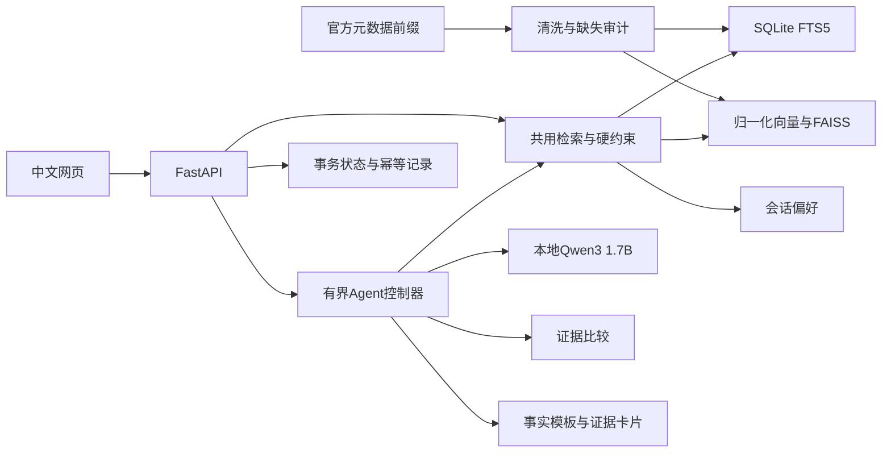

# 两周版本架构

## 数据和请求链路

`search_catalog` 与普通搜索复用 `DiscoveryService.search`，不维护第二套检索逻辑。`compare_items` 只允许本会话已展示商品，逐字段取源值；未知属性不补全。比较不把“资料没写”解释成“商品没有”。所有非空比较值都能对应卡片证据。

## 模型职责

Qwen3-1.7B 只规划动作、选择关键词与比较维度、判断结束。它通过真实生成服务产生 JSON，而非由规则伪造模型调用。应用只从有限动作集合派发，不执行模型返回的任意函数、代码或网络地址。价格、品牌、功能等最终事实通过固定模板和已验证卡片输出。

这个选择来自真实实验：小模型能够生成合法动作，但自由回答仍会照抄示例价格。合法 JSON 与事实正确是不同指标。原始失败保留在 `reports/model_compatibility*.json`，控制器以证据渲染限制这个风险。模板不代表模型已经学会事实推理。

明确的当前预算、币种与排除项由程序解析。模型无权撤销这些约束；搜索工具接受严格参数模型。金额范围或约束冲突会澄清。解析器覆盖常见中英文下限/上限/范围及部分材质排除，不能声称任意自然语言逻辑完备。

## 工程选择

| 决策 | 原因与边界 |
| --- | --- |
| SQLite + FTS5 / 精确 FAISS | 3,000 件无需分布式服务，便于复现；放大数据或多进程前须重评估 |
| 单机三进程 | 生成器串行、API 单 worker、界面无模型，便于隔离延迟和故障 |
| GPU 可见设备前置限制 | 默认 GPU5，两种模型都在其 cuda:0；启动器最多接受两张不同物理卡 |
| 显式 likes 内容画像 | 无真实曝光/交互训练数据时仍可展示可验证个性化；不假装训练 CF |
| 读操作每次独立连接、写操作即时事务 | 跨 HTTP 线程安全、反馈幂等原子提交 |
| 同会话单回合锁 | 防止并发聊天交错；仅保证单 API worker，不能直接扩成多 worker |
| 数据/索引哈希 | 发现错配时停用语义路线并明确降级，避免静默读错向量 |
| 测试中替身、验收中真模型 | CPU 快速覆盖异常路径；GPU 报告单独保留真实原始输出 |

## 状态、幂等与限制

会话是服务生成的随机 UUID。状态含查询、当前条件、最近结果顺序、可见 ID、明确喜欢/不感兴趣/收藏与最近 20 条消息。可见 ID 保留最近 1,000 个，重新展示会更新新近顺序。反馈 `event_id` 和聊天 `request_id` 在会话内唯一：重复内容重放原响应；同 ID 不同内容返回 409。反馈、状态和收据位于同一事务。搜索和比较是只读业务动作，但会记录本次可见列表与执行轨迹。

默认最多 10,000 会话；执行轨迹全局只保留最新 10,000 条。收据不自动过期，以免静默破坏幂等；本地演示使用结束后由操作者备份或重置状态库。旧收据仍可重放，但对应旧轨迹可能已被淘汰。开发评测原始请求与 trace 另存 `reports/`，不受运行轨迹清理影响。

这是本地单用户演示：会话 UUID 是持有者令牌，跨会话记录按令牌隔离，并非账户鉴权或生产 RBAC。API 默认仅回环监听，可选 Bearer API 密钥。若部署到公网，需要身份系统、TLS、用户限流、审计保留策略和容量验证。日志不记录 HTTP 请求正文；运行 trace 会含查询和模型动作，按本地数据保管。

## 与设计书的对应

完成的是设计书两周切片：真实小目录 → 共用搜索 → 显式偏好 → 两个工具 → 约束/证据/降级 → 页面 → 20 场景/演示。没有新增依赖付费接口、额外 GPU 或大规模训练的前提。两篇论文归档用于后续实验设计，本实现没有伪造复现 SAILRec 或尚未正式投稿的 WWW 工作。
